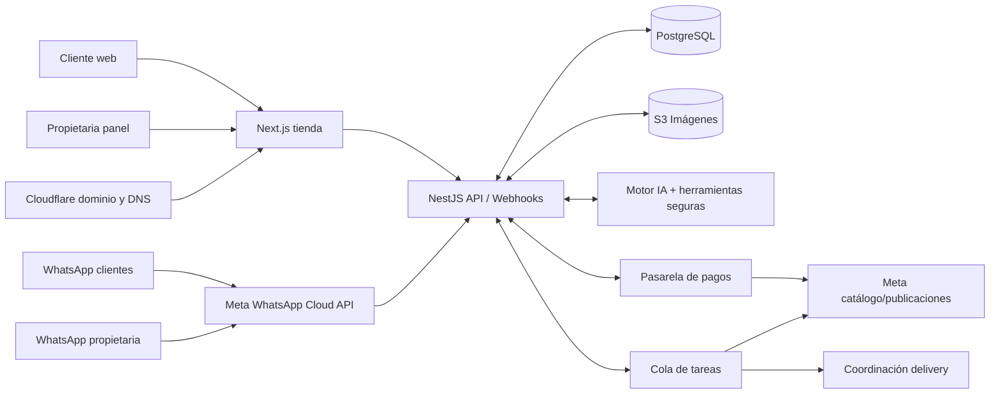

# ANGIBELL 360 — Plan técnico (SORYNTEL · Conti MIPYME Hackathon 2026)

Recomendación: construir una **plataforma de comercio electrónico con automatización comercial**, no un ERP.
Objetivo principal: **Publicar una vez. Vender por varios canales. Gestionar todo desde un solo lugar.**

Componentes núcleo (funciones que trabajan juntas):

1. Panel de productos — la propietaria registra un producto una sola vez.
2. Redes sociales — el producto aparece en la tienda y queda preparado para Facebook/Instagram.
3. Vendedor por WhatsApp — el cliente consulta, recibe recomendaciones reales, confirma pedido y obtiene enlace de pago.

## 1. Paperclip (paperclipai/paperclip)

- Plataforma MIT (Node.js/React/TypeScript) para coordinar agentes IA: tareas, presupuestos, aprobaciones, supervisión.
- **No usar en la primera versión de producción de Angibell.** Sí en segunda etapa: coordinar agentes que preparen campañas, revisen publicaciones, análisis comerciales periódicos; y como herramienta interna de SORYNTEL.

## 2. Publicación automática en Facebook e Instagram

Viabilidad por operación:

| Función                                    | Viabilidad             | Condición                                  |
| ------------------------------------------ | ---------------------- | ------------------------------------------ |
| Registrar producto en Angibell 360         | Alta                   | Controlado por SORYNTEL                    |
| Mostrarlo en la tienda                     | Alta                   | Integración interna                        |
| Sincronizar con catálogo de Meta           | Alta, condicionada     | Catálogo comercial y permisos              |
| Crear publicación en página de Facebook    | Alta, condicionada     | Acceso autorizado a la página              |
| Publicar imágenes en Instagram             | Alta, condicionada     | Cuenta profesional + permisos (p. ej. `instagram_business_content_publish`) |
| Historias, reels, etiquetas comerciales    | Parcial                | Funciones admitidas por Meta               |
| Anuncios pagados                           | Técnicamente posible   | Autorización, presupuesto y controles      |

Flujo: registrar 1 vez (fotos, nombre, precio, tallas, colores, stock) → tienda publicada + catálogo Meta sincronizado + publicación social preparada → **la propietaria revisa y aprueba** antes de publicar. La aprobación es una función, no una limitación: evitar publicaciones repetitivas por cada cambio menor.

## 3. Bot de WhatsApp vendedor

Agente comercial con acceso controlado al sistema de ventas (no un chatbot de solo preguntas).
Puede: consultar stock, recomendar prendas, responder dudas, preparar pedido, calcular envío según reglas, generar enlace de pago y consultar confirmación.

- **El dinero no lo maneja la IA.** El cliente paga por la pasarela; el backend verifica el webhook oficial y recién confirma el pedido.
- Pedidos personalizados (medidas/confección) se derivan a la propietaria para validar precio y plazo.
- Regla fundamental: la IA interpreta lo que el cliente necesita; **NestJS** consulta precios, valida inventario, crea pedidos y confirma pagos.

## 4. Arquitectura recomendada

- **Next.js + React + TypeScript** — tienda virtual, panel administrable, carrito, gestión de productos.
- **NestJS + TypeScript** — lógica comercial, chatbot, integraciones, pedidos, pagos.
- **PostgreSQL** — productos, variantes, stock, pedidos, clientes, conversaciones.
- **Meta API** (catálogo/publicaciones), **WhatsApp API**, **Culqi** (pagos).
- **Docker + AWS Lightsail** y **Cloudflare** (dominio, DNS, CDN, HTTPS).
- pnpm + monorepositorio (`web`, `api`, librerías compartidas). Sin microservicios innecesarios.
- Paperclip **fuera** del servidor de producción de Angibell (entorno independiente si se usa).

## 5. Costos

Fijos o presupuestables:

| Servicio                        | Costo referencial     | Observación                                  |
| ------------------------------- | --------------------- | -------------------------------------------- |
| Dominio .com en Cloudflare      | US$ 10.46/año         | Verificar disponibilidad                     |
| Cloudflare Free                 | US$ 0/mes             | DNS, CDN, HTTPS                              |
| AWS Lightsail 4 GB + IPv4       | US$ 24/mes            | Servidor de la aplicación                    |
| PostgreSQL en el mismo servidor | Sin instancia extra   | Menor aislamiento; backups indispensables    |
| Almacenamiento y respaldos      | US$ 3–15/mes          | Estimado según uso                           |
| API de IA                       | US$ 3–20/mes          | Sujeto a pruebas y tráfico                   |
| Correo corporativo              | US$ 0–8/mes           | Desde reenvío hasta buzón contratado         |

- Opción más segura: PostgreSQL administrado 2 GB con cifrado, **+US$ 30/mes**.
- **Escenario económico: US$ 30–70/mes. Escenario robusto: US$ 70–130/mes.** No incluyen desarrollo, mantenimiento, publicidad, mensajes de WhatsApp, comisiones, delivery ni impuestos.
- IA: GPT-5.6 Luna — US$ 0.20/M tokens entrada, US$ 1.20/M salida.

### WhatsApp (cambio de precios octubre 2026, números peruanos)

| Tipo de mensaje                 | Tarifa referencial |
| ------------------------------- | ------------------ |
| Respuesta de servicio (API)     | S/ 0.0998          |
| Confirmación / utilidad         | S/ 0.0998          |
| Mensaje publicitario            | S/ 0.2339          |
| Mensajes recibidos del cliente  | Sin cargo de Meta  |

- Franquicia indicada: 1,000 mensajes de servicio/mes por número; después se cobra.
- Inconsistencia documental: la página general de Meta aún describe las respuestas de servicio como gratuitas. **Confirmar el tarifario efectivo en la cuenta empresarial de Angibell; no presupuestar sobre la gratuidad.**
- Ejemplo: 2,000 respuestas de servicio/mes ≈ S/ 99.80 (con franquicia) o S/ 199.60 (sin ella), más IA.
- Diseñar conversaciones eficientes: respuestas agrupadas, botones, derivación a humano.

### Pasarela Culqi

- Tarjetas nacionales y Yape: 3.44% + US$ 0.20 por operación. Internacionales: 3.99% + US$ 0.20.
- Comisión mínima S/ 3.50 para ciertos pagos < S/ 87.72. Plin y otras billeteras: confirmar tarifa.
- No son gasto fijo: escalan con las ventas.

### Prueba de 150 días

- Reserva estimada: **US$ 150–350** (escenario económico, ~5 meses) + dominio, mensajes, pagos, trabajo del equipo e incidencias.
- Propuesta: 150 días sin cobrar licencia ni desarrollo, con presupuesto acordado y **topes de consumo** para servicios externos. Si SORYNTEL asume AWS/WhatsApp/IA, fijar límites antes de ofrecerlo como "totalmente gratis".
- Desarrollo primera versión de producción: **250–450 horas** técnicas (tienda, administración, pagos, bot, publicación social, pruebas). Aprobaciones de Meta añaden tiempo calendario.

## 9. Alcance para la hackathon (cierre domingo)

Para la demo:

- Tienda con catálogo administrable — demo funcional.
- Crear productos y actualizar stock — demo funcional.
- Chatbot vendedor — demo en web o entorno controlado (WhatsApp API oficial después).
- Pago con Culqi — entorno de pruebas.
- Publicar en Facebook/Instagram — demostración del flujo y preparación de publicaciones (conexión real después).
- AWS + Cloudflare — opcional para la demo.
- Panel de pedidos — versión básica.

No prometer publicación real en IG ni bot de WhatsApp en producción sin accesos/permisos de Meta.

## 10. Viabilidad

| Componente                             | Viabilidad   | Riesgo principal                       |
| -------------------------------------- | ------------ | -------------------------------------- |
| Next.js, NestJS, PostgreSQL            | Alta         | Tiempo de desarrollo y pruebas         |
| AWS + Docker                           | Alta         | Costos, respaldos, seguridad           |
| Tienda y catálogo administrable        | Alta         | Calidad de datos y fotografías         |
| Facebook/Instagram automáticos         | Media-alta   | Permisos y restricciones de Meta       |
| Bot vendedor WhatsApp                  | Media-alta   | Aprobaciones, costos, precisión        |
| Pagos por pasarela                     | Alta         | Habilitación comercial y conciliación  |
| Paperclip en procesos internos         | Viable       | Complejidad adicional                  |

**Pregunta decisiva antes de integrar:** ¿Angibell dará acceso de administrador al portafolio Meta Business, su página de Facebook y su cuenta empresarial de Instagram? Sin esos permisos se puede construir toda la lógica y el prototipo, pero no garantizar la publicación automática real.

---

## Orquestación IA de SORYNTEL

- Orquestador local: opencode (PC de Nando) — recibe las instrucciones y delega.
- Orquestadores remotos (esta PC, 172.16.5.56): **codex** y **agy** (Antigravity), con la skill **impeccable** global.
- Puente de delegación: `orquestadores/delegar.sh <codex|agy>` (prompt por stdin) invocado por SSH.

---

# Arquitectura v2 — WhatsApp como centro de administración (revisión ING. AXIOM)

La propietaria gestiona casi todo su negocio **desde WhatsApp**; la plataforma funciona por detrás. Se separan dos herramientas distintas:

- **Orquestador de desarrollo** — coordina agentes de IA que programan, prueban y mejoran la plataforma.
- **Orquestador de operaciones** — coordina tareas de Angibell: publicar productos, consultar pedidos, responder clientes, actualizar inventario.

## Admin desde WhatsApp (con panel web de respaldo)

- Ejemplo: fotografía + "Agrégalo a la tienda, talla 6 y 8, precio 120 soles" → el asistente prepara el registro y **pide confirmación** antes de publicar.
- **Condición:** mantener panel web para revisar muchos productos, corregir inventarios, resolver errores y administrar accesos.
- Dos asistentes separados sobre la misma infraestructura:
  - **Administrativo** (propietaria): productos, publicaciones, ventas, precios, pedidos.
  - **Comercial** (clientes): recomendar prendas, resolver dudas, carritos, enlaces de pago, derivar casos especiales.

## Jev

- Modelo especializado en decisiones estructuradas (clasificar intenciones, elegir opciones, puntuar información). API recibe datos y devuelve respuestas para otro programa.
- Podría clasificar mensajes (agregar producto / consultar pedido / actualizar stock), **pero no es núcleo del sistema**: NestJS valida y ejecuta. Optimizador posterior, no introducirlo todavía.
- Pendiente aclarar: ¿"Jev" = modelo de TypeSafe o un servicio de alojamiento? (decide arquitectura).

## Orquestador de desarrollo (comparativa)

| Herramienta   | Aporta                                                    | Evaluación                             |
| ------------- | --------------------------------------------------------- | -------------------------------------- |
| Paperclip     | Organiza agentes, tareas, presupuestos, aprobaciones      | Muy interesante para desarrollo posterior |
| Claude Code   | Programa y delega a subagentes especializados             | Primera opción para desarrollar ahora  |
| OpenAI Codex  | Desarrolla funcionalidades, pruebas y revisión de código  | Excelente alternativa                  |
| n8n           | Conecta WhatsApp, servicios y automatizaciones            | Prototipos e integraciones auxiliares  |
| BullMQ        | Procesos ordenados, reintentos, seguimiento               | Automatizaciones de producción         |

- Paperclip soporta agentes vía Claude Code, Codex y otros adaptadores; Claude Code dispone de subagentes.
- **Roles:** agente coordinador (arquitectura/requisitos/integración/revisión), frontend (Next.js), backend (NestJS/PostgreSQL/pagos), automatización (WhatsApp/integraciones), QA y seguridad, y **revisión humana de SORYNTEL** antes de integrar o desplegar.
- Los agentes deben trabajar con **tareas delimitadas, contratos de API compartidos y ramas separadas**.
- **Advertencia:** más agentes no significan más velocidad. Primero cerrar reglas comerciales y contratos de datos (productos, variantes, pedidos, pagos, mensajes); después programar en paralelo.

## Producción

- NestJS = núcleo comercial. BullMQ = tareas en segundo plano (colas, reintentos) — no perder trabajo si falla Facebook/servidor.
- n8n solo para experimentar; **no** poner lógica crítica (inventario, reservas de stock, pagos) en flujos visuales.
- WhatsApp vía **Cloud API oficial de Meta** (considerar reglas de plantillas, ventana de atención y costos).
- Orquestador de desarrollo **fuera** del servidor comercial (separado de datos y credenciales de clientes).

## Stack primera implementación

| Capa                        | Tecnología                                     |
| --------------------------- | ---------------------------------------------- |
| Desarrollo asistido por IA  | Claude Code / Codex (Paperclip después)        |
| Tienda + panel de respaldo  | Next.js + TypeScript                           |
| Servicios comerciales       | NestJS                                         |
| Datos de negocio            | PostgreSQL                                     |
| Automatización de tareas    | BullMQ (cuando se requieran colas)             |
| Agente conversacional       | Modelo IA con herramientas restringidas        |
| WhatsApp                    | Cloud API oficial de Meta                      |
| Servidor                    | AWS Lightsail + Docker                         |
| Dominio y protección        | Cloudflare                                     |

## Seguridad que no se negocia

- Verificar que toda orden administrativa venga de **números autorizados**.
- **Confirmación** antes de cambiar precios o publicar; **registrar quién autorizó** cada acción.
- El chatbot **no** hace reembolsos, no modifica datos bancarios, no elimina productos por instrucción ambigua.
- No confiar solo en que el modelo interprete la identidad del usuario.

## Costos v2

- AWS Lightsail 4 GB + IPv4: **US$24/mes** (contenedores de tienda, API, BD y auxiliares; respaldos externos y monitoreo).
- **Presupuesto global provisional: US$35–80/mes** para operación pequeña, antes de comisiones, mensajería, publicidad y mantenimiento. No es cotización cerrada.

## Demo para la hackathon (recorrido único)

Propietaria envía foto por WhatsApp → sistema prepara el producto → propietaria confirma → aparece en la tienda → se prepara publicación para Meta → cliente conversa con el bot → se genera pedido + **enlace de pago de prueba**. (Más convincente que pantallas aisladas.)

## Recomendación final v2

- Desarrollo a largo plazo: **Paperclip + Claude Code/Codex**, con GitHub como repositorio y control de versiones.
- Operación de Angibell: **NestJS + agente comercial por WhatsApp**.
- Jev: optimizador posterior para clasificar mensajes a menor costo.

---

# Arquitectura del sistema (diagrama)

Flujo y responsabilidades:

1. **Entrada web:** Cliente web, panel de la propietaria y Cloudflare (dominio + DNS) pasan por **Next.js (tienda + panel)** → **NestJS API**.
2. **Entrada WhatsApp:** los WhatsApp de **clientes** y de la **propietaria** entran por la **Meta WhatsApp Cloud API** → **NestJS API / Webhooks** (única entrada oficial, con reglas de plantillas y ventana de atención).
3. **Núcleo comercial (NestJS):** único punto que valida y ejecuta. Se conecta bidireccionalmente con:
   - **PostgreSQL** — datos de negocio (productos, variantes, stock, pedidos, clientes, conversaciones).
   - **S3 Imágenes** — fotos de productos y assets.
   - **Motor IA + herramientas seguras** — el modelo interpreta; solo accede por herramientas restringidas; nunca decide precios, stock ni pagos por sí solo.
   - **Pasarela de pagos** — Culqi; el pago se confirma solo con la verificación del webhook en el backend.
   - **Cola de tareas** — BullMQ; procesos asíncronos con reintentos (publicaciones, notificaciones, delivery).
4. **Salidas asíncronas:** la **Cola de tareas** alimenta **Meta catálogo/publicaciones** (sincronización y publicaciones aprobadas) y la **Coordinación de delivery**.

La IA nunca toca la base de datos, la pasarela ni Meta directamente: todo pasa por el API con permisos, validación y auditoría.
